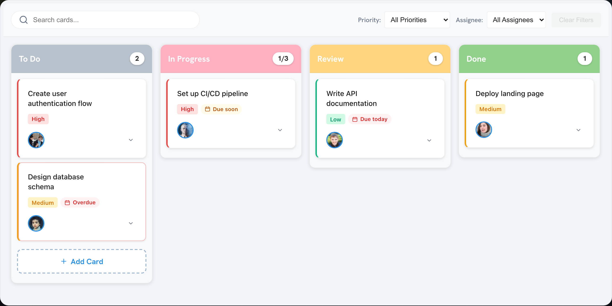
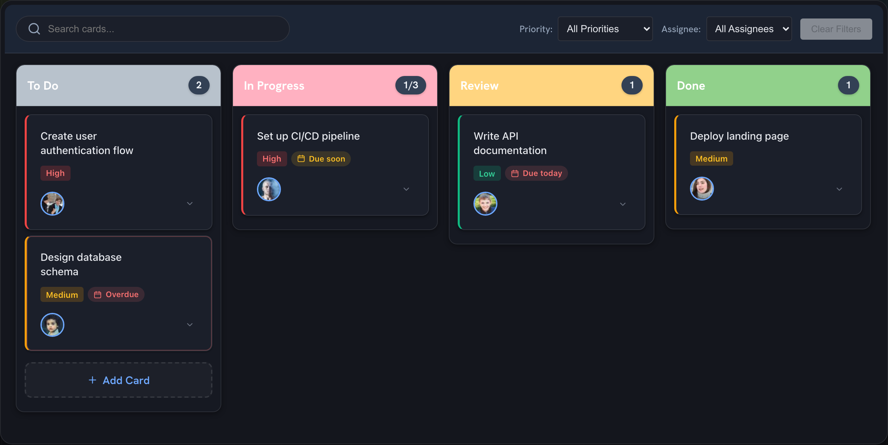
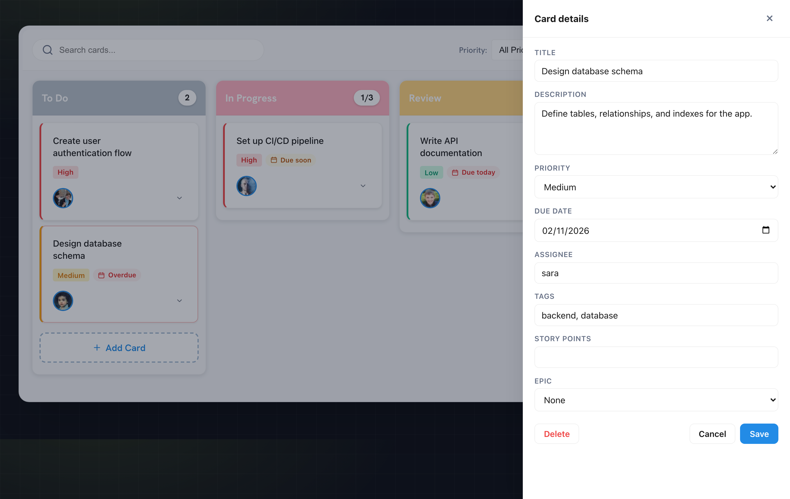
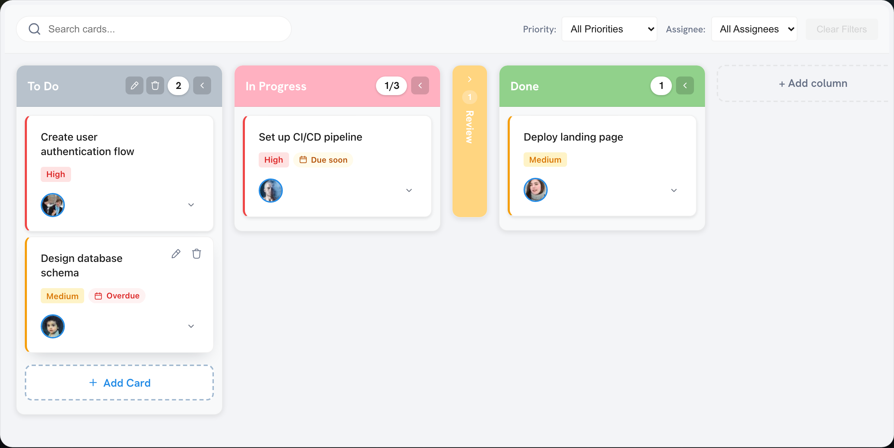
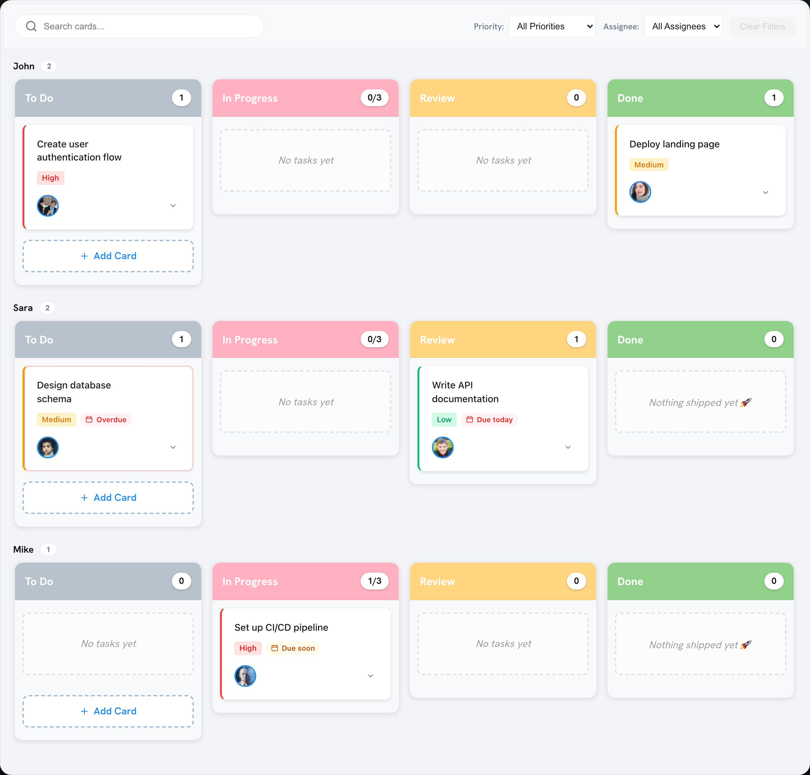
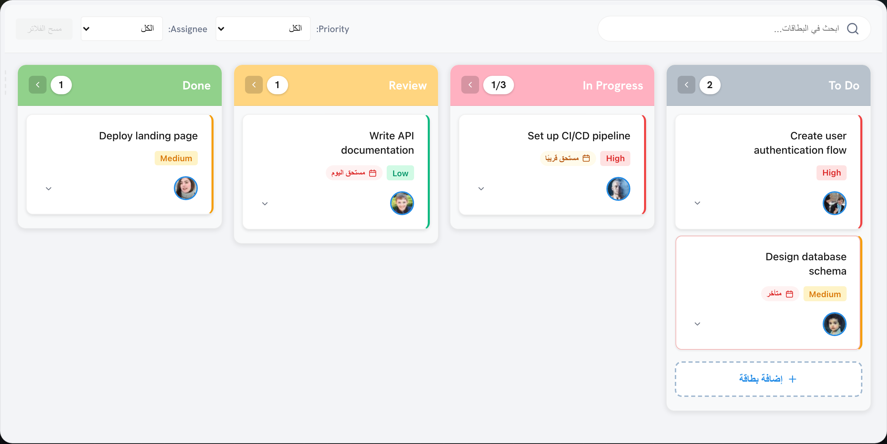

# react-custom-kanban-board

A customizable, accessible Kanban board for React. Drag cards with a mouse, a
finger or the keyboard; wire it to a backend with controlled state and
optimistic persistence; let users manage columns and edit cards in a details
panel; or skip the UI entirely and build your own board on the headless
`useKanban` hook.


<sub>The tour, in order: drag &amp; drop · reorder · WIP limits · keyboard drag · search &amp; filters · card details · add cards · delete with undo · column tools · multi-select &amp; bulk move · swimlanes · dark theme · RTL + translations · custom cards · 300+ cards virtualized · load more. Try it yourself: <code>npm run dev</code>.</sub>

<table>
  <tr>
    <td width="50%"><br /><sub><b>Default theme</b> — priorities, due-date chips, WIP limit</sub></td>
    <td width="50%"><br /><sub><b>Dark theme</b> — <code>className="kb-dark"</code></sub></td>
  </tr>
  <tr>
    <td><br /><sub><b>Card details panel</b> — <code>enableCardDetails</code></sub></td>
    <td><br /><sub><b>Column tools</b> — rename, delete, collapse, add</sub></td>
  </tr>
  <tr>
    <td><br /><sub><b>Swimlanes</b> — <code>swimlaneBy="assignee"</code></sub></td>
    <td><br /><sub><b>RTL + translations</b> — <code>dir="rtl"</code> + <code>labels</code></sub></td>
  </tr>
</table>

## Features

- **Drag and drop everywhere** — mouse, touch (press-and-hold) and keyboard
  (<kbd>Space</kbd> to pick up, arrows to move, <kbd>Space</kbd>/<kbd>Enter</kbd>
  to drop, <kbd>Esc</kbd> to cancel) with screen-reader announcements, powered
  by [dnd-kit](https://dndkit.com/). Columns auto-scroll while dragging.
- **Works in every React setup** — React 16.8 → 19, ESM + CommonJS, server-side
  rendering and the Next.js App Router (`"use client"` is built in).
- **Controlled or uncontrolled state**, plus `usePersistentBoard` for
  optimistic backend sync with automatic rollback.
- **Headless mode** — `useKanban()` gives you the board's state and operations
  (move, add, update, delete cards; add, rename, delete, reorder columns)
  without any UI.
- **Card details panel** — double-click a card to edit every field, including
  your own typed custom fields.
- **Column management** — add, rename, delete, collapse and drag-to-reorder
  columns.
- **Priorities & due dates** — custom priority levels and colours; overdue /
  due-today / due-soon highlighting.
- **Search, filters, WIP limits, swimlanes, multi-select bulk actions,
  delete confirmation / undo, per-column loading, empty states and load-more.**
- **Large boards** — opt-in column virtualization for hundreds of cards.
- **i18n & RTL** — every UI string is overridable via `labels`; `dir="rtl"`
  mirrors the layout.
- **Theming** — `--kb-*` design tokens and a ready-made dark theme.
- **Fully typed** — pass your own card type: `<KanbanBoard<MyCard> … />`.

## Installation

```bash
npm install react-custom-kanban-board
```

The board styles itself: on the client it injects its stylesheet once
(unless the stylesheet is already on the page). You can also load the CSS
yourself, which is recommended for server-rendered apps (no flash of unstyled
content) and required with a strict Content-Security-Policy:

```js
import "react-custom-kanban-board/styles.css";
// optionally also: <KanbanBoard injectStyles={false} ... />
```

> **Upgrading from 2.0?** 3.0 is a drop-in upgrade — no code changes needed.
> Every 2.0 prop, callback, type and import path works as before; see
> [Backward compatibility](#backward-compatibility-with-20).

## Usage

### Basic Example

```jsx
import KanbanBoard from "react-custom-kanban-board";

const columns = [
  { title: "To Do", key: "todo", color: "#BDBDCD", allowAddCard: true },
  { title: "In Progress", key: "in-progress", color: "#FDDDE3", limit: 3 },
  { title: "Done", key: "done", color: "#71C781", isDone: true },
];

const initialCards = [
  { id: "1", title: "Task 1", status: "todo", priority: "High", dueDate: "2026-12-01" },
  { id: "2", title: "Task 2", status: "in-progress", avatarPath: "https://i.pravatar.cc/40?img=2" },
];

export default function App() {
  return (
    <KanbanBoard
      columns={columns}
      initialCards={initialCards}
      onCardMove={(id, status, position) => console.log(id, status, position)}
    />
  );
}
```

### Next.js (App Router) and SSR

The package's client entry is already marked `"use client"`, so you can render
the board from a Server Component page. Import the CSS in your root layout so
the server-rendered HTML is styled from the first paint:

```tsx
// app/layout.tsx
import "react-custom-kanban-board/styles.css";

// app/board/page.tsx (a Server Component)
import KanbanBoard from "react-custom-kanban-board";

export default async function BoardPage() {
  const cards = await db.cards.findMany();
  return <KanbanBoard columns={columns} initialCards={cards} />;
}
```

Pure helpers (CSV/JSON export, `moveCard`, `diffCards`, `validateCard`, …) are
also published without the client directive, for use in server code:

```ts
import { exportCardsToCSV, moveCard } from "react-custom-kanban-board/utils";
```

### TypeScript

Every component and hook is generic over your card type:

```tsx
import KanbanBoard, { type BaseCard } from "react-custom-kanban-board";

interface Ticket extends BaseCard {
  storyPoints: number;
  epic: "auth" | "billing";
}

<KanbanBoard<Ticket>
  columns={columns}
  initialCards={tickets}
  swimlaneBy="epic" // type-checked against Ticket's keys
  onCardUpdate={(id, patch) => api.update(id, patch)} // patch: Partial<Ticket>
/>;
```

### Advanced Example with Chakra UI Integration

Here's how to integrate the Kanban board with Chakra UI for enhanced UI components:

```jsx
import React, { useState, useEffect, useRef } from "react";
import KanbanBoard from "react-custom-kanban-board";
import {
  ChakraProvider,
  InputGroup,
  Input,
  InputLeftElement,
  InputRightElement,
  IconButton,
  Box,
  Text,
  Menu,
  MenuButton,
  MenuList,
  MenuItem,
  Button,
  Divider,
  extendTheme,
} from "@chakra-ui/react";
import { SearchIcon, ChevronDownIcon, CloseIcon } from "@chakra-ui/icons";
import "./App.css";

// Create a theme
const theme = extendTheme({
  // Your theme customizations here (optional)
});

const App = () => {
  // Sample columns with WIP limits
  const columns = [
    { title: "To Do", key: "todo", color: "#B8C2CC" },
    { title: "In Progress", key: "in-progress", color: "#FFB1C1", limit: 3 }, // WIP limit
    { title: "Review", key: "review", color: "#FFD580" },
    { title: "Done", key: "done", color: "#91D18B" },
  ];

  // Sample cards data
  const initialCards = [
    {
      id: "1",
      title: "Create user authentication flow",
      status: "todo",
      avatarPath: "https://i.pravatar.cc/40?img=1",
      priority: "High",
      dueDate: "2023-06-30",
      tags: ["frontend", "auth"],
      description:
        "Implement user registration, login, and password reset flows.",
      assignee: "john",
    },
    // ... more cards
  ];

  // Filter configurations
  const filterConfigs = [
    {
      field: "priority",
      label: "Priority",
      options: [
        { value: "High", label: "High Priority" },
        { value: "Medium", label: "Medium Priority" },
        { value: "Low", label: "Low Priority" },
      ],
    },
    // ... more filter configs
  ];

  const [cards, setCards] = useState(initialCards);
  const [loading, setLoading] = useState(true);

  // Simulate loading data
  useEffect(() => {
    setTimeout(() => {
      setLoading(false);
    }, 1500);
  }, []);

  // Custom Search Input Component using Chakra UI
  const CustomSearchInput = ({ searchTerm, setSearchTerm }) => {
    const inputRef = useRef(null);

    return (
      <InputGroup size="md" maxW="400px">
        <InputLeftElement pointerEvents="none">
          <SearchIcon color="gray.400" />
        </InputLeftElement>
        <Input
          ref={inputRef}
          value={searchTerm}
          onChange={(e) => setSearchTerm(e.target.value)}
          placeholder="Find tasks..."
          borderRadius="full"
          bg="white"
          borderColor="gray.300"
        />
        {searchTerm && (
          <InputRightElement>
            <IconButton
              size="sm"
              variant="ghost"
              icon={<CloseIcon w={3} h={3} />}
              onClick={() => {
                setSearchTerm("");
                inputRef.current?.focus();
              }}
              aria-label="Clear search"
            />
          </InputRightElement>
        )}
      </InputGroup>
    );
  };

  // Custom Filter Menu Component using Chakra UI
  const CustomFilterMenu = ({ config, selectedValue, onChange }) => {
    const selectedOption = config.options.find(
      (opt) => opt.value === selectedValue
    );
    const displayValue = selectedOption
      ? selectedOption.label
      : `All ${config.label}s`;

    return (
      <Box mx={2}>
        <Text fontSize="xs" color="gray.500" mb={1}>
          {config.label}
        </Text>
        <Menu closeOnSelect={true}>
          <MenuButton
            as={Button}
            rightIcon={<ChevronDownIcon />}
            size="sm"
            variant="outline"
            w="160px"
          >
            {displayValue}
          </MenuButton>
          <MenuList zIndex={100}>
            <MenuItem
              onClick={() => onChange(config.field, null)}
              fontWeight={!selectedValue ? "bold" : "normal"}
            >
              All {config.label}s
            </MenuItem>
            <Divider />
            {config.options.map((option) => (
              <MenuItem
                key={option.value}
                onClick={() => onChange(config.field, option.value)}
                fontWeight={selectedValue === option.value ? "bold" : "normal"}
              >
                {option.label}
              </MenuItem>
            ))}
          </MenuList>
        </Menu>
      </Box>
    );
  };

  // Wrapper functions to match the expected function signature
  const customSearchWrapper = (searchTerm, setSearchTerm) => {
    return (
      <CustomSearchInput
        searchTerm={searchTerm}
        setSearchTerm={setSearchTerm}
      />
    );
  };

  const customFilterWrapper = (config, selectedValue, onChange) => {
    return (
      <CustomFilterMenu
        config={config}
        selectedValue={selectedValue}
        onChange={onChange}
      />
    );
  };

  return (
    <ChakraProvider theme={theme}>
      <div className="app-container">
        <header className="app-header">
          <h1>Project Task Board</h1>
        </header>

        <main className="board-container">
          <KanbanBoard
            columns={columns}
            initialCards={cards}
            isLoading={loading}
            emptyColumnMessage="No tasks yet"
            enableSearch={true}
            enableFiltering={true}
            filterConfigs={filterConfigs}
            renderSearchInput={customSearchWrapper}
            renderFilterMenu={customFilterWrapper}
          />
        </main>
      </div>
    </ChakraProvider>
  );
};

export default App;
```

## Card details panel

Set `enableCardDetails` and users can double-click a card (or use its open
button) to edit the title, description, priority, due date, assignee, tags and
any `cardFields` you define. Saving fires `onCardUpdate(cardId, patch)` with
only the fields that changed.

```jsx
<KanbanBoard
  columns={columns}
  initialCards={cards}
  cardFields={[{ key: "storyPoints", label: "Story points", type: "number" }]}
  enableCardDetails
  onCardUpdate={(id, patch) => api.updateCard(id, patch)}
  // Add your own content under the form (comments, checklists, history...)
  renderCardDetailsExtra={(card) => <Comments cardId={card.id} />}
/>
```

Use `renderCardDetails(card, { update, close, remove })` to replace the panel
body entirely. Custom `renderCard` functions receive a fifth `actions`
argument (`isDragging`, `edit`, `delete`, `openDetails`, `isSelected`) so
custom cards can trigger the same flows.

## Column management

```jsx
<KanbanBoard
  columns={columns}
  initialCards={cards}
  enableColumnManagement // add, rename (double-click the title) and delete columns
  enableColumnCollapse // collapse columns to a narrow strip (still a drop target)
  enableColumnReorder // drag columns by their grip
  onColumnsChange={(next) => saveColumns(next)}
  onColumnDelete={(key, removedCardIds) => api.deleteColumn(key, removedCardIds)}
/>
```

Column edits work out of the box; pass `onColumnsChange` to persist them (and
feed the result back through `columns` if you keep columns in your own state).
Set `collapsed: true` on a column to start it collapsed, and
`renderColumnHeader(column, info)` to draw your own header.

## Priorities & due dates

```jsx
<KanbanBoard
  priorities={[
    { value: "P0", label: "Urgent", color: "#dc2626" },
    { value: "P1", label: "High", color: "#f97316" },
    { value: "P2", label: "Normal", color: "#64748b" },
  ]}
  dueSoonDays={3} // "Due soon" window (default 2 days)
  columns={[...columns, { key: "done", title: "Done", color: "#71C781", isDone: true }]}
  initialCards={cards}
/>
```

Cards with a `dueDate` (ISO `YYYY-MM-DD`) show an **Overdue**, **Due today** or
**Due soon** chip. Columns marked `isDone` are never highlighted. Turn it off
with `highlightDueDates={false}`.

> TypeScript: the default `Card` type keeps 2.0's `"Low" | "Medium" | "High"`
> priority union. For custom priority values, type your cards as
> `BaseCard` (or an interface extending it), whose `priority` is a `string`.

## Translations & RTL

Every built-in string can be overridden with `labels` (see
[`KanbanLabels`](./docs/API.md#kanbanlabels)); `dir="rtl"` mirrors the layout:

```jsx
<KanbanBoard
  dir="rtl"
  labels={{
    addCard: "إضافة بطاقة",
    searchPlaceholder: "ابحث في البطاقات...",
    overdue: "متأخر",
    wipReached: (limit) => `تم بلوغ الحد (${limit})`,
  }}
  columns={columns}
  initialCards={cards}
/>
```

## Load more (pagination)

Give a column `hasMore: true` and handle `onLoadMore(columnKey)`. A load-more
trigger at the bottom of the column calls it when scrolled into view (or when
clicked); set `isLoadingMore` while the request is in flight.

```jsx
const columns = [
  { key: "done", title: "Done", color: "#71C781", hasMore: page.hasNext, isLoadingMore: loading },
];

<ControlledKanbanBoard
  columns={columns}
  cards={cards}
  onCardsChange={setCards}
  onLoadMore={async (key) => {
    setLoading(true);
    const next = await api.cards({ column: key, cursor: page.cursor });
    setCards((prev) => [...prev, ...next.items]);
    setPage(next);
    setLoading(false);
  }}
/>;
```

## Search, filters & WIP limits

```jsx
const columns = [
  { title: "To Do", key: "todo", color: "#BDBDCD" },
  { title: "In Progress", key: "doing", color: "#FDDDE3", limit: 3 }, // WIP limit
  { title: "Done", key: "done", color: "#71C781" },
];

<KanbanBoard
  columns={columns}
  initialCards={cards}
  enableSearch
  searchFields={["title", "description", "tags"]} // default: ["title"]
  enableFiltering
  filterConfigs={[
    {
      field: "priority",
      label: "Priority",
      options: [
        { value: "High", label: "High" },
        { value: "Medium", label: "Medium" },
        { value: "Low", label: "Low" },
      ],
    },
    { field: "tags", label: "Tag", options: [{ value: "frontend", label: "Frontend" }] },
  ]}
  onFilterChange={(filters) => console.log(filters)} // { priority: "High" }
/>;
```

A drop that would push a column over its `limit` is rejected and the column
shows a "WIP limit reached" notice. Use `renderSearchInput` /
`renderFilterMenu` to plug in your own UI library (see the Chakra example
above).

## Custom cards & column headers

```tsx
<KanbanBoard
  columns={columns}
  initialCards={cards}
  renderCard={(card, _handleDragStart, isExpanded, toggleExpand, actions) => (
    <div className={actions.isDragging ? "my-card dragging" : "my-card"}>
      <strong>{card.title}</strong>
      {isExpanded && <p>{card.description}</p>}
      <button onClick={() => toggleExpand(card.id)}>{isExpanded ? "Less" : "More"}</button>
      <button onClick={actions.edit}>Rename</button>
      <button onClick={actions.openDetails}>Open</button>
      <button onClick={actions.delete}>Delete</button>
    </div>
  )}
  renderColumnHeader={(column, { count, limit, isLimitExceeded }) => (
    <span style={{ color: isLimitExceeded ? "crimson" : undefined }}>
      {column.title} · {count}
      {limit !== undefined ? ` / ${limit}` : ""}
    </span>
  )}
/>
```

The whole card is the drag handle (mouse, touch and keyboard), and clicks on
buttons inside it still work. `actions.delete` honours `deleteConfirmation`.

## Swimlanes

```jsx
<KanbanBoard
  columns={columns}
  initialCards={cards}
  swimlaneBy="assignee" // group rows by any card field
  swimlanes={[
    { value: "sara", label: "Sara" },
    { value: "john", label: "John" },
  ]} // optional: explicit order + labels (derived from the cards otherwise)
  onCardMove={(cardId, newStatus, position) => api.moveCard(cardId, newStatus, position)}
  onCardsChange={(next) => save(next)} // a card dragged to another lane has its `assignee` updated
/>
```

Cards without a value for the field go into an "Ungrouped" lane.

## Multi-select & bulk actions

```jsx
<KanbanBoard
  columns={columns}
  initialCards={cards}
  enableMultiSelect // Cmd/Ctrl-click to toggle, Shift-click to select a range
  onBulkMove={(cardIds, newStatus) => api.moveMany(cardIds, newStatus)}
  onBulkDelete={(cardIds) => api.deleteMany(cardIds)}
/>
```

Selecting cards shows a bulk bar with "Move to <column>", "Delete" and "Clear".

## Delete confirmation & undo

```jsx
<KanbanBoard
  columns={columns}
  initialCards={cards}
  deleteConfirmation="undo" // "immediate" (default) | "confirm" | "undo"
  undoDuration={4000} // ms before the delete is committed
  onCardDelete={(cardId) => api.deleteCard(cardId)} // fires after the undo window
/>
```

`"confirm"` asks inline before deleting; `"undo"` removes the card at once and
shows an Undo toast, calling `onCardDelete` only if the user doesn't undo.

## Headless: `useKanban`

Build a completely custom board (or drive the built-in one programmatically)
with the same state engine:

```tsx
import { useKanban } from "react-custom-kanban-board";

function MyBoard() {
  const kanban = useKanban({ columns, initialCards });
  return (
    <div className="grid">
      {kanban.columns.map((col) => (
        <section key={col.key}>
          <h2>{col.title}</h2>
          {kanban.getColumnCards(col.key).map((card) => (
            <article key={card.id}>
              {card.title}
              <button onClick={() => kanban.moveCard(card.id, "done")}>Done</button>
            </article>
          ))}
          <button onClick={() => kanban.addCard(col.key, { title: "New" })}>+</button>
        </section>
      ))}
    </div>
  );
}
```

`moveCard` respects WIP limits and returns the resulting `DropPosition`. The
same operation is available as a pure function — `moveCard(cards, id,
toColumn, toIndex, columns)` from `react-custom-kanban-board/utils` — for
servers, tests, or applying moves received over a websocket.

## Realtime collaboration

Because the board is fully controllable (`cards` + `onCardsChange`), wiring it to
a websocket or a Convex-style live query is just: broadcast local changes and
set `cards` from remote state. `diffCards` turns two card lists into a minimal
patch so you can send changes (not the whole board) over the wire:

```jsx
import {
  diffCards,
  applyCardChanges,
  ControlledKanbanBoard,
} from "react-custom-kanban-board";

const channel = new BroadcastChannel("board"); // or a websocket

<ControlledKanbanBoard
  cards={cards}
  onCardsChange={(next) => {
    const patch = diffCards(cards, next); // [{type:'move', id, from, to}, ...]
    channel.postMessage(patch); // send only what changed
    setCards(next);
  }}
  columns={columns}
/>;

// Apply remote patches by setting `cards` — the board just re-renders.
channel.onmessage = (e) => setCards((prev) => applyCardChanges(prev, e.data));
```

Each `CardChange` is `add` / `remove` / `move` / `update` (a card that moved
and was edited yields a `move` and an `update`), and `applyCardChanges(cards,
changes)` applies them. The demo's **Realtime
sync** toggle syncs two browser tabs live via `BroadcastChannel`.

## Activity log

`useActivityLog` builds a lightweight per-card audit trail from the board's
callbacks (moved / renamed / deleted):

```jsx
import { useActivityLog } from "react-custom-kanban-board";

const log = useActivityLog({ actor: "you", limit: 50 });

<KanbanBoard
  columns={columns}
  initialCards={cards}
  onCardMove={log.onCardMove}
  onCardEdit={log.onCardEdit}
  onCardDelete={log.onCardDelete}
/>;

{log.entries.map((e) => (
  <li key={e.id}>
    {e.cardId} {e.detail} {e.actor && `· by ${e.actor}`}
  </li>
))}
```

Each entry has `{ id, type, cardId, timestamp, detail, actor }`. Use
`log.record(type, cardId, detail)` to append custom entries and `log.clear()`
to reset.

## Custom card fields (typed schema)

Beyond the built-in `priority` / `dueDate` / `tags` / `assignee`, describe your
own fields with a typed schema. They render in the default card's expanded
details and can be validated with `validateCard`.

```tsx
import { validateCard, type CardFieldDef } from "react-custom-kanban-board";

const cardFields: CardFieldDef[] = [
  { key: "storyPoints", label: "Story points", type: "number" },
  {
    key: "epic",
    label: "Epic",
    type: "select",
    options: [
      { value: "auth", label: "Authentication" },
      { value: "infra", label: "Infrastructure" },
    ],
    required: true,
  },
];

<KanbanBoard columns={columns} initialCards={cards} cardFields={cardFields} />;

// Validate before saving:
const errors = validateCard(cards[0], cardFields); // string[] (empty = valid)
```

For full type-safety, describe your cards with your own type:
`interface MyCard extends BaseCard { storyPoints: number; epic: string }` and
render `<KanbanBoard<MyCard> ... />` (see [TypeScript](#typescript)).

## Backend persistence (optimistic + rollback)

The `usePersistentBoard` hook wires a controlled board to a backend: mutations
apply instantly (optimistic), and if a backend call rejects, the board rolls
back to the previous state and calls `onError`.

```jsx
import { usePersistentBoard, ControlledKanbanBoard } from "react-custom-kanban-board";

function Board() {
  const board = usePersistentBoard(initialCards, {
    onCardMove: (id, status, pos) => api.moveCard(id, status, pos),
    onCardEdit: (id, title) => api.renameCard(id, title),
    onCardDelete: (id) => api.deleteCard(id),
    onError: () => toast("Couldn't save — reverted"),
  });

  return (
    <ControlledKanbanBoard
      columns={columns}
      cards={board.cards}
      onCardsChange={board.onCardsChange}
      onCardMove={board.onCardMove}
      onCardEdit={board.onCardEdit}
      onCardDelete={board.onCardDelete}
    />
  );
}
```

`board.isSyncing` is `true` while a backend call is in flight. Each adapter
method returns a `Promise`; a rejection triggers the rollback.

## Export / import

Pure helpers to snapshot or migrate a board's cards as JSON or CSV (no React
dependency — usable on the server too):

```jsx
import {
  exportCardsToJSON,
  exportCardsToCSV,
  importCardsFromJSON,
  importCardsFromCSV,
} from "react-custom-kanban-board";

const json = exportCardsToJSON(cards); // pretty-printed JSON
const csv = exportCardsToCSV(cards); // array fields (tags) joined with "|"

const cards1 = importCardsFromJSON(json); // validates id/title/status
const cards2 = importCardsFromCSV(csv); // parses quoted fields correctly
```

Invalid input throws a descriptive `Error`. CSV export includes the core card
fields plus any extra scalar fields; CSV values import back as strings.

## Theming

The board is styled entirely through `--kb-*` CSS variables (design tokens), so
you can reskin it without fighting selector specificity. Override them globally
on `:root`, or scope them to one board via the `className` / `style` props.

A ready-made dark theme ships as `.kb-dark`:

```jsx
<KanbanBoard className="kb-dark" columns={columns} initialCards={cards} />
```

Or set your own tokens inline / in a scoped class:

```tsx
import type { CSSProperties } from "react";

<KanbanBoard
  columns={columns}
  initialCards={cards}
  style={
    {
      "--kb-accent": "#7c3aed",
      "--kb-card-radius": "16px",
      "--kb-priority-high": "#e11d48",
    } as CSSProperties
  }
/>;
```

Key tokens (see `src/KanbanBoard.css` / `styles.css` for the full set):

| Token | Purpose |
| --- | --- |
| `--kb-board-bg` / `--kb-column-bg` / `--kb-card-bg` | Surfaces |
| `--kb-text` / `--kb-text-muted` | Text |
| `--kb-accent` / `--kb-hover-bg` | Accent & interaction |
| `--kb-border` / `--kb-radius` / `--kb-card-radius` | Lines & radii |
| `--kb-shadow` / `--kb-shadow-hover` | Elevation |
| `--kb-priority-high` / `--kb-priority-medium` / `--kb-priority-low` | Priority accents |
| `--kb-font` | Font family |

> Previous variable names (`--card-bg`, `--accent-color`, …) still work as
> aliases, so existing overrides keep functioning.

## Virtualization (experimental)

For boards with very large columns (hundreds of cards), set
`virtualizeColumnsOver` to window each column's list so only the visible cards
are rendered. It's **off by default** and fully non-breaking.

```jsx
<KanbanBoard
  columns={columns}
  initialCards={cards}
  virtualizeColumnsOver={50} // window any column with > 50 cards
  virtualItemEstimatedHeight={120}
/>
```

In testing, a 300-card column dropped from ~6,200 DOM nodes to ~350 (only ~13
cards rendered). Drag-and-drop (mouse, touch, keyboard) keeps working for
visible cards, and the `onCardMove` / `DropPosition` contract is unchanged.

> **⚠️ Caveats (why it's still experimental):**
>
> - Dragging auto-scrolls the column, and the card being dragged stays mounted
>   while it scrolls out of view, so long-distance reorders work in one motion.
> - No live "make room" shift animation inside virtualized columns.
> - Best for read-heavy large boards; if you need long-distance drags across a
>   huge column, leave virtualization off for that board.

## Controlled vs. uncontrolled

The board works in two modes:

**Uncontrolled (default)** — pass `initialCards` and let the board own its state.
When `initialCards` changes to different data (for example after a fetch), the
board shows the new cards, as in 2.0; a re-render that passes an equal array
keeps the user's ordering. Use the callbacks (`onCardMove`, `onCardReorder`,
`onCardEdit`, `onCardDelete`, `onCardsChange`) to observe changes.

```jsx
<KanbanBoard columns={columns} initialCards={initialCards} />
```

**Controlled** — pass `cards` and `onCardsChange`. The board renders `cards`
directly and never mutates internal state, so it stays perfectly in sync with a
backend or external store. Every change hands you the full next list.

```jsx
import { ControlledKanbanBoard } from "react-custom-kanban-board";

const [cards, setCards] = useState(initialCards);

<ControlledKanbanBoard
  columns={columns}
  cards={cards}
  onCardsChange={setCards} // persist to your backend here too
/>;
```

`ControlledKanbanBoard` is a thin, type-safe wrapper that makes `cards` and
`onCardsChange` required. You can also just pass `cards` + `onCardsChange` to the
regular `KanbanBoard`.

## Backward compatibility with 2.0

3.0 is a drop-in upgrade. Code written for 2.0 keeps working, unchanged:

- **Styles** are still applied automatically (injected on the client). The 2.0
  path `react-custom-kanban-board/dist/KanbanBoard.css` still exists.
- **Props & callbacks** — `columnForAddCard`, `onTaskAddedCallback`,
  `onCardMove(cardId, newStatus)` (still only for moves to another column),
  `onCardEdit`, `onCardDelete`, `renderAddCard`, search / filter props: all
  unchanged. Same-column reorders are reported through the new, separate
  `onCardReorder`.
- **`initialCards`** — changing it to new data still updates the board.
- **`renderCard(card, handleDragStart, isExpanded, toggleExpand)`** — same
  signature. Dragging is now handled for every card (mouse, touch, keyboard),
  so `handleDragStart` is a harmless no-op and a `draggable` attribute on your
  card is neutralised; `isDragging` is available in the new fifth `actions`
  argument.
- **Types** — `Card`, `Column`, `FilterConfig`, `FilterOption` are unchanged
  (`Card.priority` keeps its union type, `Column.color` is still a string).
- **Search** matches titles, as in 2.0 (`searchFields` opts into more fields).
- **Imports** — `main` / `types` are the same files; `module` is now a real
  ES module (`dist/esm/index.js`), so bundlers can tree-shake it.

For example, this 2.0 code runs unchanged on 3.0 — styled, draggable, and with
the same callbacks:

```jsx
import KanbanBoard from "react-custom-kanban-board"; // no CSS import needed

<KanbanBoard
  columns={[
    { title: "To Do", key: "todo", color: "#BDBDCD" },
    { title: "Done", key: "done", color: "#71C781" },
  ]}
  initialCards={cards}
  columnForAddCard="todo"
  onCardMove={(cardId, newStatus) => api.updateStatus(cardId, newStatus)}
  onTaskAddedCallback={(title) => api.createTask(title)}
  renderCard={(card, handleDragStart) => (
    <div draggable onDragStart={(e) => handleDragStart(e, card)}>
      {card.title}
    </div>
  )}
/>;
```

To adopt the new features gradually, add props as you need them, e.g.
`onCardReorder` for same-column ordering, `allowAddCard` on more columns, or
`enableCardDetails`.

Drag-and-drop now uses [dnd-kit](https://dndkit.com/), installed automatically
as a dependency. It's released as a major version so you upgrade on purpose:
if your own end-to-end tests simulate native `dragstart` / `drop` events, or
your CSS targets internal wrapper elements, check those after upgrading.

## Everything the package exports

From `react-custom-kanban-board` (client entry, marked `"use client"`):

| Export | What it is |
| --- | --- |
| `KanbanBoard` (default export) | The board component. Generic over your card type: `<KanbanBoard<MyCard> />`. |
| `ControlledKanbanBoard` | Same board with `cards` + `onCardsChange` required (type-safe controlled mode). |
| `useKanban(options)` | Headless state engine — cards, columns and every board operation without UI. See [Headless](#headless-usekanban). |
| `usePersistentBoard(initialCards, adapter)` | Controlled state with optimistic updates and automatic rollback when a backend call fails. See [Backend persistence](#backend-persistence-optimistic--rollback). |
| `useActivityLog(options)` | Per-card audit trail built from the board callbacks. See [Activity log](#activity-log). |
| `defaultLabels` | The built-in English UI strings (`KanbanLabels`) — spread it to build a translation. |
| everything below | Re-exported here too, for convenience. |

From `react-custom-kanban-board/utils` (no React, no `"use client"` — safe in server code):

| Export | What it does |
| --- | --- |
| `moveCard(cards, cardId, toColumn, toIndex?, columns?)` | Moves a card to a column / position. Returns `{ nextCards, destColumn, position }`, `{ wipBlockedColumn }` when a WIP limit blocks it, or `null`. |
| `filterCards(cards, searchTerm, filters, searchFields?)` | The board's search + filter logic (title-only search by default). |
| `getDueStatus(dueDate, soonDays?, now?)` | `"overdue"`, `"today"`, `"soon"` or `null` — the rule behind the due-date chips. |
| `computeReorder(cards, columns, activeId, overId)` | Low-level drop computation used by drag-and-drop (`overId` is a card id or `column:<key>`). |
| `computeSwimlaneReorder(cards, columns, activeId, overId, swimlaneBy)` | Same, for swimlane boards (a drop can change the lane field too). |
| `diffCards(prev, next)` | Minimal add / remove / move / update patches between two card lists. See [Realtime collaboration](#realtime-collaboration). |
| `applyCardChanges(cards, changes)` | Applies `diffCards` patches (e.g. received from another client) to a card list. |
| `exportCardsToJSON` / `importCardsFromJSON` / `exportCardsToCSV` / `importCardsFromCSV` | Board export / import. See [Export / import](#export--import). |
| `validateCard(card, cardFields)` | Validates a card against your `CardFieldDef` schema; returns error messages. |

Stylesheet: `react-custom-kanban-board/styles.css` (also at the 2.0 path
`react-custom-kanban-board/dist/KanbanBoard.css`). It is injected
automatically unless you import it yourself.

Types: `Card`, `BaseCard`, `Column`, `DropPosition`, `CardActions`,
`RenderCard`, `ColumnHeaderInfo`, `CardDetailsHelpers`, `PriorityDef`,
`CardFieldDef`, `FilterConfig`, `FilterOption`, `DeleteConfirmation`,
`KanbanBoardProps`, `ControlledKanbanBoardProps`, `KanbanLabels`,
`UseKanbanOptions`, `KanbanController`, `MoveResult`, `PersistenceAdapter`,
`PersistentBoard`, `ActivityEntry`, `ActivityLog`, `CardChange`, `DueStatus`,
`ReorderResult` — documented in [`docs/API.md`](./docs/API.md).

## Props

> **📖 Authoritative API reference:** [`docs/API.md`](./docs/API.md) is generated
> directly from the TypeScript source (`npm run docs`) and never drifts from the
> actual types. The tables below are a hand-maintained summary; when in doubt,
> trust the generated reference.

### KanbanBoard Component Props

| Prop                  | Type                                                                                                                                                              | Default          | Description                                                                                                           |
| --------------------- | ----------------------------------------------------------------------------------------------------------------------------------------------------------------- | ---------------- | --------------------------------------------------------------------------------------------------------------------- |
| `columns`             | `Column[]`                                                                                                                                                        | `[]`             | Array of columns to display. Each object should include `title`, `key`, and `color`.                                  |
| `initialCards`        | `Card[]`                                                                                                                                                          | `[]`             | **Uncontrolled mode.** Seeds the board's internal card state once, on mount. Later changes to this prop are ignored (see [Controlled vs. uncontrolled](#controlled-vs-uncontrolled)). |
| `cards`               | `Card[]`                                                                                                                                                          | -                | **Controlled mode.** When provided, the board renders these cards directly and never mutates internal state. Pair with `onCardsChange`. |
| `onCardsChange`       | `(cards: Card[]) => void`                                                                                                                                         | -                | Called with the full next card list on every mutation (move, edit, delete, add). Required for controlled mode; also fires in uncontrolled mode. |
| `className`           | `string`                                                                                                                                                          | -                | Applied to the board root — use it to scope a theme (e.g. `"kb-dark"`). See [Theming](#theming). |
| `style`               | `React.CSSProperties`                                                                                                                                             | -                | Applied to the board root — handy for setting `--kb-*` tokens inline.                                |
| `columnForAddCard`    | `string`                                                                                                                                                          | -                | Key of the column that shows the "Add card" control. (Still supported; `allowAddCard` on each column can enable several.) |
| `onCardAdd`           | `(card: Card, columnKey: string) => void`                                                                                                                         | -                | Called after a card is created from the built-in "Add card" control. |
| `createCardId`        | `() => string`                                                                                                                                                    | random UUID      | Id generator for cards created by the board. |
| `onCardUpdate`        | `(cardId: string, patch: Partial<Card>) => void`                                                                                                                  | -                | Called with the changed fields whenever a card is edited (inline title edit or the details panel). |
| `enableCardDetails`   | `boolean`                                                                                                                                                         | `false`          | Double-click a card (or its open button) to edit all fields in a side panel. See [Card details panel](#card-details-panel). |
| `renderCardDetails` / `renderCardDetailsExtra` | `(card, helpers) => ReactNode` / `(card) => ReactNode`                                                                                    | -                | Replace the details panel body / add content under the built-in form. |
| `enableColumnManagement` | `boolean`                                                                                                                                                      | `false`          | Add, rename and delete columns. See [Column management](#column-management). |
| `enableColumnCollapse` | `boolean`                                                                                                                                                        | `false`          | Let users collapse columns to a narrow strip. |
| `onColumnsChange`     | `(columns: Column[]) => void`                                                                                                                                     | -                | Called with the next column list after columns are added, renamed, deleted or reordered. Also `onColumnAdd`, `onColumnRename`, `onColumnDelete`, `onColumnCollapseChange`. |
| `renderColumnHeader`  | `(column: Column, info: ColumnHeaderInfo) => ReactNode`                                                                                                           | -                | Custom column header (title, counter, collapse state). |
| `priorities`          | `PriorityDef[]`                                                                                                                                                   | Low/Medium/High  | Priority levels with optional label and colour. |
| `highlightDueDates` / `dueSoonDays` | `boolean` / `number`                                                                                                                                | `true` / `2`     | Overdue / due-today / due-soon highlighting. |
| `onLoadMore`          | `(columnKey: string) => void`                                                                                                                                     | -                | Called when a column with `hasMore` scrolls its load-more trigger into view. |
| `labels`              | `Partial<KanbanLabels>`                                                                                                                                           | English          | Override any UI string (translations). |
| `searchFields`        | `string[]`                                                                                                                                                        | `["title"]`      | Card fields the search box matches (e.g. `["title", "description", "tags"]`). |
| `injectStyles`        | `boolean`                                                                                                                                                         | `true`           | Inject the default stylesheet on the client (skipped if `styles.css` is already loaded). Set `false` with a strict CSP and import the CSS yourself. |
| `styleNonce`          | `string`                                                                                                                                                          | -                | CSP nonce for the injected `<style>` tag. |
| `dir`                 | `"ltr" \| "rtl"`                                                                                                                                                  | -                | Text direction; `"rtl"` mirrors the layout. |
| `onCardMove`          | `(cardId: string, newStatus: string, position: DropPosition) => void`                                                                                             | -                | Called when a card is moved to another column (as in 2.0). `position` exposes where the card landed within the destination column. |
| `onCardReorder`       | `(cardId: string, status: string, position: DropPosition) => void`                                                                                                | -                | Called when a card is reordered within its column. |
| `onCardEdit`          | `(cardId: string, newTitle: string) => void`                                                                                                                      | -                | Callback function when a card is edited.                                                                              |
| `onCardDelete`        | `(cardId: string) => void`                                                                                                                                        | -                | Callback function when a card is deleted.                                                                             |
| `onTaskAddedCallback` | `(title: string) => void`                                                                                                                                         | -                | Called with the new card's title (`onCardAdd` also gives you the created card).                                       |
| `renderCard`          | `(card: Card, handleDragStart, isExpanded?: boolean, toggleExpand?: (id: string) => void, actions?: CardActions) => ReactNode`                                     | -                | Custom function to render cards (2.0 signature). The card is wrapped in a drag handle automatically, so `handleDragStart` is a no-op kept for compatibility. `actions` exposes `isDragging`, `edit`, `delete`, `openDetails` and `isSelected`. |
| `renderAvatar`        | `(avatarPath?: string) => ReactNode`                                                                                                                              | -                | Custom function to render avatars.                                                                                    |
| `renderAddCard`       | `(column: string, setCards: React.Dispatch<React.SetStateAction<Card[]>>) => ReactNode`                                                                           | -                | Custom function to render the add card button.                                                                        |
| `isLoading`           | `boolean`                                                                                                                                                         | `false`          | Shows loading spinner when true.                                                                                      |
| `loadingComponent`    | `ReactNode`                                                                                                                                                       | -                | Custom loading component.                                                                                             |
| `emptyColumnMessage`  | `string`                                                                                                                                                          | `"No cards yet"` | Default message shown when a column is empty (a column's `emptyMessage` overrides this).                              |
| `renderColumnLoading` | `(column: Column) => ReactNode`                                                                                                                                   | -                | Custom per-column loading UI, shown for any column with `isLoading: true`. Falls back to a built-in skeleton.         |
| `enableColumnReorder` | `boolean`                                                                                                                                                         | `false`          | Enable drag-to-reorder of columns via a grip in each column header (mouse, touch, keyboard).                          |
| `onColumnsReorder`    | `(orderedKeys: string[]) => void`                                                                                                                                 | -                | Called with the new ordered column keys after a column is reordered.                                                  |
| `swimlaneBy`          | `string`                                                                                                                                                          | -                | Group cards into horizontal swimlanes by a card field (e.g. `"assignee"`). Dragging a card to another lane updates that field. |
| `swimlanes`           | `{ value: string; label: string }[]`                                                                                                                              | -                | Explicit swimlanes (value + label + order). Derived from card values when omitted.                                   |
| `enableMultiSelect`   | `boolean`                                                                                                                                                         | `false`          | Enable multi-select (Cmd/Ctrl-click to toggle, Shift-click for a range) with a bulk action bar (move / delete).       |
| `onBulkMove`          | `(cardIds: string[], newStatus: string) => void`                                                                                                                  | -                | Called when selected cards are moved to a column in bulk.                                                             |
| `onBulkDelete`        | `(cardIds: string[]) => void`                                                                                                                                     | -                | Called when selected cards are deleted in bulk.                                                                       |
| `deleteConfirmation`  | `"immediate" \| "confirm" \| "undo"`                                                                                                                              | `"immediate"`    | Guards card deletion before `onCardDelete` fires. `confirm` shows an inline prompt; `undo` removes the card and shows a brief undo toast, deferring `onCardDelete`. |
| `virtualizeColumnsOver` | `number`                                                                                                                                                        | -                | **Experimental.** Virtualize (window) a column's list once it exceeds this many cards, for large-board performance. See [Virtualization](#virtualization-experimental) for caveats. |
| `virtualItemEstimatedHeight` | `number`                                                                                                                                                   | `120`            | Estimated card height (px) used by the virtualizer.                                                                  |
| `undoDuration`        | `number`                                                                                                                                                          | `5000`           | How long (ms) the undo toast stays before the delete is committed (only used with `deleteConfirmation="undo"`).       |
| `enableSearch`        | `boolean`                                                                                                                                                         | `false`          | Enable search functionality.                                                                                          |
| `enableFiltering`     | `boolean`                                                                                                                                                         | `false`          | Enable filtering functionality.                                                                                       |
| `filterConfigs`       | `FilterConfig[]`                                                                                                                                                  | `[]`             | Configuration for filters.                                                                                            |
| `onFilterChange`      | `(filters: Record<string, string \| null>) => void`                                                                                                               | -                | Callback when filters change.                                                                                         |
| `renderSearchInput`   | `(searchTerm: string, setSearchTerm: (term: string) => void) => ReactNode`                                                                                        | -                | Custom function to render search input.                                                                               |
| `renderFilterMenu`    | `(config: FilterConfig, value: string \| null, handleFilterChange: (field: string, value: string \| null) => void) => ReactNode`                                  | -                | Custom function to render filter menu.                                                                                |

### Column Interface

| Property | Type     | Description                        |
| -------- | -------- | ---------------------------------- |
| `title`        | `string`  | Title of the column.                                                        |
| `key`          | `string`  | Unique key for the column.                                                  |
| `color`        | `string`  | Background color for the column header.                                     |
| `allowAddCard` | `boolean` | Show the "Add card" control in this column.                                 |
| `isDone`       | `boolean` | A "done" column: due dates are not highlighted as overdue here.             |
| `collapsed`    | `boolean` | Start collapsed (with `enableColumnCollapse`).                              |
| `hasMore` / `isLoadingMore` | `boolean` | More cards can be fetched (shows a load-more trigger) / a fetch is in flight. |
| `limit`        | `number`  | Optional WIP limit for the column.                                         |
| `isLoading`    | `boolean` | Optional per-column loading state (e.g. lazy-loaded data). Shows a skeleton or `renderColumnLoading`. |
| `emptyMessage` | `string`  | Optional per-column empty message; overrides the board's `emptyColumnMessage`. |

### Card Interface

| Property        | Type       | Description                                     |
| --------------- | ---------- | ----------------------------------------------- |
| `id`            | `string`   | Unique identifier for the card.                 |
| `title`         | `string`   | Title of the card.                              |
| `status`        | `string`   | Status of the card, corresponds to column key.  |
| `avatarPath`    | `string`   | URL to the avatar image.                        |
| `priority`      | `string`   | Priority level ("High", "Medium", "Low", or any value from `priorities`). |
| `dueDate`       | `string`   | Due date (ISO `YYYY-MM-DD`); drives overdue / due-soon highlighting. |
| `tags`          | `string[]` | Array of tags for the card.                     |
| `description`   | `string`   | Detailed description of the card.               |
| `assignee`      | `string`   | Person assigned to the card.                    |
| `[key: string]` | `any`      | Any additional custom properties you need.      |

### DropPosition Interface

Passed as the third argument to `onCardMove` and `onCardReorder`, describing where the card landed within its destination column. This makes it easy to persist ordering on a backend (e.g. by storing the previous/next task ids).

| Property     | Type             | Description                                                                            |
| ------------ | ---------------- | -------------------------------------------------------------------------------------- |
| `prevTaskId` | `string \| null` | Id of the card immediately **before** the dropped card, or `null` if dropped at the top.    |
| `nextTaskId` | `string \| null` | Id of the card immediately **after** the dropped card, or `null` if dropped at the bottom.  |
| `index`      | `number`         | Zero-based index of the dropped card within the destination column.                    |

```jsx
<KanbanBoard
  columns={columns}
  initialCards={cards}
  onCardMove={(cardId, newStatus, { prevTaskId, nextTaskId, index }) => {
    // Moved to another column: persist status + position
    api.reorderTask({ cardId, column: newStatus, prevTaskId, nextTaskId, index });
  }}
  onCardReorder={(cardId, column, { prevTaskId, nextTaskId, index }) => {
    // Reordered within its column
    api.reorderTask({ cardId, column, prevTaskId, nextTaskId, index });
  }}
/>
```

### FilterConfig Interface

| Property  | Type             | Description                                        |
| --------- | ---------------- | -------------------------------------------------- |
| `field`   | `string`         | Field to filter by (e.g., "priority", "assignee"). |
| `label`   | `string`         | Display label for the filter.                      |
| `options` | `FilterOption[]` | Array of available filter options.                 |

### FilterOption Interface

| Property | Type     | Description                          |
| -------- | -------- | ------------------------------------ |
| `value`  | `string` | Value of the filter option.          |
| `label`  | `string` | Display label for the filter option. |

## Development

```bash
npm install            # install deps
npm run dev            # preview the component (demo/) at http://localhost:5173
npm run build          # build the library to dist/ (ESM + CJS + types + styles.css)
npm run typecheck      # type-check the source
npm test               # Playwright end-to-end suite (drives the demo)
npm run test:package   # load the built package in plain Node (CJS, ESM, SSR)
npm run test:types     # compile a consumer file against the published .d.ts
npm run test:readme    # type-check every code example in this README
npm run lint:package   # publint + are-the-types-wrong on the packed tarball
npm run size           # bundle-size budget (size-limit)
npm run docs           # regenerate docs/API.md from the TypeScript source
npm run build:demo     # static build of the playground (deployed to GitHub Pages)
```

The end-to-end tests in `test/` drive the demo app (which renders the library
straight from `src/`), so they exercise real drag-and-drop, delete, loading,
column tools, the details panel and controlled/uncontrolled behavior in a
browser. CI runs all of the above on every pull request.

## Contributing

Contributions are welcome! Please open an issue or submit a pull request on GitHub.

## Contact

For any questions or issues, please contact [HamdyIIbarhim](mailto:hamdyfarouk444@gmail.com).
